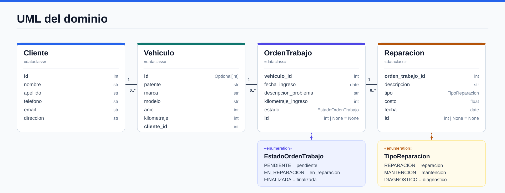
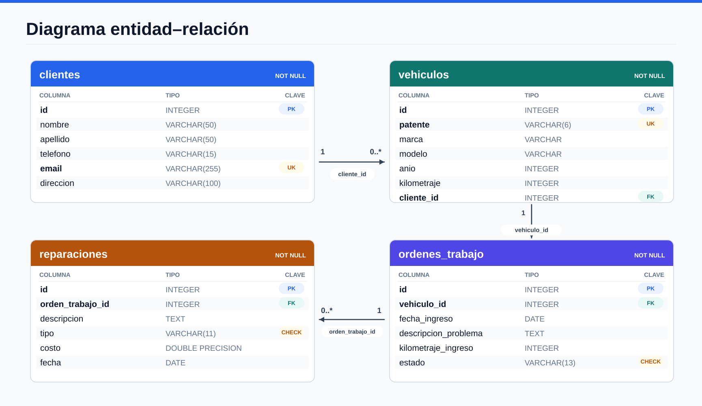
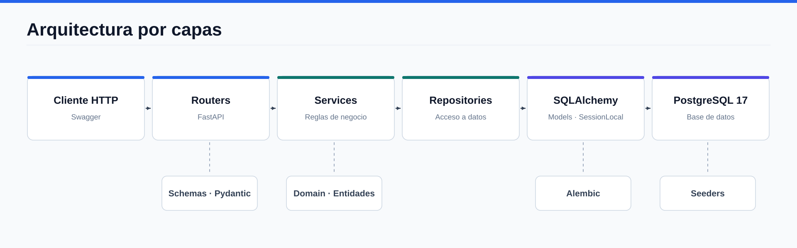

# Proyecto Backend - Taller Mecánico

Proyecto orientado al desarrollo de una API REST para apoyar la gestión de un taller mecánico.

## Problema a trabajar

Los talleres mecánicos pequeños suelen registrar la información de sus clientes, vehículos, órdenes de trabajo y reparaciones de forma manual o poco organizada. Esto dificulta el seguimiento de los trabajos realizados, el estado de las reparaciones y el historial de cada vehículo.

El proyecto busca centralizar esta información en un sistema que permita gestionarla de manera más ordenada y eficiente.

## Integrantes

| Nombre | Correo institucional | Responsabilidad |
|---|---|---|
| **Carlos Nahuelcoy** | cnahuelcoy2026@alu.uct.cl | Clientes, integración, Docker y documentación. |
| **Gonzalo Albornoz** | galbornoz2026@alu.uct.cl | Reparaciones y seeders. |
| **Rodrigo Sevilla** | rsevilla2026@alu.uct.cl | Vehículos y migraciones con Alembic. |
| **Matías Salinas** | matias.salinas2026@alu.uct.cl | Órdenes de trabajo y pruebas automatizadas. |

## Módulos del sistema

El sistema se divide en cuatro módulos principales:

- **Clientes:** registro y administración de los datos de los clientes.
- **Vehículos:** gestión de los vehículos asociados a cada cliente.
- **Órdenes de Trabajo:** registro y seguimiento de los trabajos realizados a los vehículos.
- **Reparaciones:** administración de las reparaciones asociadas a cada orden de trabajo.

Los módulos se relacionan de la siguiente manera:

`Cliente → Vehículo → Orden de Trabajo → Reparación`

## Estructura del proyecto

El proyecto está organizado por capas para separar las responsabilidades del sistema.

```text
backend-2026-grupo-06/
├── docs/
│   ├── diagramas/
│   │   ├── arquitectura-capas.svg
│   │   ├── erd-postgresql.svg
│   │   └── uml-dominio.svg
│   ├── migraciones.md
│   ├── pruebas.md
│   ├── seeders.md
│   └── solicitudes.http
├── migrations/
│   ├── versions/
│   │   └── 0001_esquema_inicial.py
│   ├── env.py
│   └── script.py.mako
├── scripts/
│   └── seed_db.py
├── src/
│   └── proyectobackend/
│       ├── database/
│       ├── domain/
│       ├── models/
│       ├── repositories/
│       ├── routers/
│       ├── schemas/
│       ├── services/
│       └── main.py
├── tests/
│   ├── __init__.py
│   ├── soporte_api.py
│   ├── test_clientes.py
│   ├── test_integracion.py
│   └── test_revision_final.py
├── .dockerignore
├── .env.example
├── .gitignore
├── alembic.ini
├── compose.yaml
├── Dockerfile
├── pyproject.toml
├── README.md
└── uv.lock
```

**Organización principal:**

- `routers/`: recibe las solicitudes HTTP y entrega las respuestas.
- `schemas/`: define los DTO y las validaciones con Pydantic.
- `domain/`: contiene las entidades y reglas del dominio.
- `services/`: implementa la lógica de negocio.
- `repositories/`: administra el acceso a los datos.
- `models/`: define los modelos de SQLAlchemy.
- `database/`: configura la conexión a la base de datos.
- `migrations/`: contiene las migraciones de Alembic.
- `scripts/`: permite cargar datos iniciales.
- `tests/`: contiene las pruebas automatizadas.
- `docs/`: contiene documentación técnica y solicitudes HTTP de prueba.

## Arquitectura

El backend utiliza una arquitectura por capas basada en el siguiente flujo:

`Cliente HTTP → Router → Service → Repository → Base de datos`

Esta separación permite mantener las rutas independientes de la lógica de negocio y del almacenamiento.

La persistencia se realiza mediante SQLAlchemy, utilizando PostgreSQL en Docker y SQLite como alternativa para desarrollo local y pruebas.

## Diagramas del sistema

### UML de clases

Representa las cuatro entidades del dominio y sus relaciones.



### Diagrama entidad-relación

Muestra las tablas, claves y relaciones de la base de datos.



### Arquitectura por capas

Muestra el recorrido de una solicitud desde la API hasta PostgreSQL.



## Dependencias actuales

El proyecto utiliza las siguientes dependencias y tecnologías:

- Python >= 3.13
- FastAPI >= 0.141.1
- Pydantic >= 2.13.5
- SQLAlchemy >= 2.1.4
- Uvicorn >= 0.52.4
- Alembic >= 1.16
- Psycopg >= 3.3.6
- PostgreSQL 17
- SQLite
- Docker y Docker Compose
- unittest (biblioteca estándar de Python)

La gestión de dependencias y del entorno del proyecto se realiza mediante `uv`.

## Instalación y ejecución con Docker

El proyecto utiliza Docker Compose para ejecutar dos contenedores: uno para FastAPI y otro para PostgreSQL 17.

### Requisitos

- Git
- Docker Desktop con Docker Compose

### Configuración

Clonar el repositorio:

```powershell
git clone https://github.com/cnahuelcoy/backend-2026-grupo-06.git
cd backend-2026-grupo-06
```

Crear el archivo de variables de entorno:

```powershell
Copy-Item .env.example .env
```

Editar `.env` y reemplazar `POSTGRES_PASSWORD` por una contraseña propia.

El archivo `.env` está excluido de Git para evitar publicar credenciales.

### Iniciar el proyecto por primera vez

Construir la imagen:

```powershell
docker compose build
```

Iniciar PostgreSQL:

```powershell
docker compose up -d db
```

Aplicar la migración inicial sobre una base de datos nueva:

```powershell
docker compose run --rm backend uv run --no-sync alembic upgrade head
```

Iniciar la API:

```powershell
docker compose up -d backend
```

Comprobar los contenedores:

```powershell
docker compose ps
```

### Acceder a la API

- **API:** http://localhost:8000
- **Swagger/OpenAPI:** http://localhost:8000/docs

Desde Swagger se pueden consultar los endpoints, revisar los esquemas y realizar solicitudes directamente desde el navegador.

### Detener el proyecto

```powershell
docker compose down
```

Los datos de PostgreSQL se conservan en un volumen persistente.

En ejecuciones posteriores, cuando la base ya esté preparada, basta con:

```powershell
docker compose up -d
```

## Migraciones de base de datos

El proyecto utiliza Alembic para administrar las migraciones. La migración inicial `0001` crea las tablas de clientes, vehículos, órdenes de trabajo y reparaciones, incluyendo sus relaciones y restricciones.

Para comprobar las migraciones:

```powershell
docker compose exec backend uv run --no-sync alembic current
docker compose exec backend uv run --no-sync alembic check
```

En una instalación correctamente migrada se espera la versión `0001 (head)` y el mensaje `No new upgrade operations detected.`.

Si las tablas ya existían antes de configurar Alembic, es necesario respaldar y revisar la base antes de utilizar `alembic stamp head`.

Más información en [docs/migraciones.md](docs/migraciones.md).

## Datos iniciales (Seeders)

El proyecto incluye un seeder que carga dos clientes, dos vehículos, dos órdenes de trabajo y dos reparaciones relacionadas.

Para ejecutarlo con Docker:

```powershell
docker compose exec backend uv run --no-sync python scripts/seed_db.py
```

Para verificar los registros:

```powershell
docker compose exec backend uv run --no-sync python scripts/seed_db.py --verificar
```

El seeder está preparado para ejecutarse nuevamente sin duplicar sus datos iniciales. También permite comprobar el rollback ante un error controlado.

Estas pruebas y los datos utilizados se explican en [docs/seeders.md](docs/seeders.md).

## Pruebas automatizadas

El proyecto cuenta con **42 pruebas automatizadas** utilizando `unittest`.

Las pruebas comprueban las operaciones de los cuatro módulos, validaciones de datos, códigos de respuesta HTTP, filtros, ordenamiento, paginación, relaciones entre entidades y persistencia después de reiniciar la API.

Para ejecutarlas localmente se requiere Python 3.13 o superior y `uv`.

Desde la raíz del repositorio, instalar las dependencias:

```powershell
uv sync --frozen
```

Ejecutar las pruebas:

```powershell
uv run --no-sync python -B -W error::ResourceWarning -m unittest discover -s tests -t . -v
```

**Resultado de la verificación realizada en Windows:**

```text
Ran 42 tests in 54.947s

OK
```

Las pruebas utilizan bases SQLite temporales y aisladas, por lo que no modifican los datos de PostgreSQL.

También se pueden ejecutar desde Docker:

```powershell
docker compose exec backend uv run --no-sync python -B -m unittest discover -s tests -t . -v
```

El detalle de los casos probados se encuentra en [docs/pruebas.md](docs/pruebas.md).

## Pruebas HTTP con REST Client

El archivo [docs/solicitudes.http](docs/solicitudes.http) contiene **60 solicitudes HTTP** para probar los endpoints de Clientes, Vehículos, Órdenes de Trabajo y Reparaciones.

Utilizamos la extensión **REST Client** de VS Code como alternativa a Postman. Las solicitudes incluyen casos correctos, errores de validación y comprobaciones de reglas de negocio.

### Ejecutar las solicitudes

**1. Iniciar una API temporal**

Con Python y `uv` instalados, ejecutar desde la raíz del proyecto:

```powershell
uv run --no-sync python -B -c "from tests.soporte_api import ApiDePrueba; api=ApiDePrueba(); api.iniciar(); print('URL:', api.url, flush=True); input('Presiona Enter para cerrar la API...'); api.cerrar()"
```

La terminal mostrará una dirección como esta:

```text
URL: http://127.0.0.1:62977
```

El puerto se asigna automáticamente y puede cambiar en cada ejecución.

**2. Configurar la dirección en REST Client**

Abrir `docs/solicitudes.http` y reemplazar temporalmente:

```http
@baseUrl = http://127.0.0.1:1
```

por la URL indicada en la terminal.

**3. Enviar las solicitudes**

Mantener la API funcionando y utilizar **Send Request** en VS Code. Las solicitudes deben ejecutarse en orden, ya que algunas utilizan los ID creados anteriormente.

Al terminar, restaurar `@baseUrl = http://127.0.0.1:1` y presionar Enter en la terminal para cerrar la API temporal.

Esta forma de probar utiliza una base SQLite independiente, sin modificar PostgreSQL.

## Endpoints de la API

La API implementa operaciones REST sobre los cuatro módulos.

| Método | Endpoint | Descripción |
|---|---|---|
| POST | `/clientes` | Crear cliente. |
| GET | `/clientes` | Listar clientes. |
| GET | `/clientes/{cliente_id}` | Consultar cliente por ID. |
| PATCH | `/clientes/{cliente_id}` | Actualizar cliente. |
| DELETE | `/clientes/{cliente_id}` | Eliminar cliente. |
| POST | `/vehiculos/` | Crear vehículo. |
| GET | `/vehiculos/` | Listar vehículos. |
| GET | `/vehiculos/{vehiculo_id}` | Consultar vehículo por ID. |
| PATCH | `/vehiculos/{vehiculo_id}` | Actualizar vehículo. |
| DELETE | `/vehiculos/{vehiculo_id}` | Eliminar vehículo. |
| POST | `/ordenes-trabajo` | Crear orden de trabajo. |
| GET | `/ordenes-trabajo` | Listar órdenes de trabajo. |
| GET | `/ordenes-trabajo/{orden_id}` | Consultar orden por ID. |
| PATCH | `/ordenes-trabajo/{orden_id}` | Actualizar orden de trabajo. |
| POST | `/reparaciones/` | Crear reparación. |
| GET | `/reparaciones/` | Listar reparaciones. |
| GET | `/reparaciones/{reparacion_id}` | Consultar reparación por ID. |
| PATCH | `/reparaciones/{reparacion_id}` | Actualizar reparación. |
| DELETE | `/reparaciones/{reparacion_id}` | Eliminar reparación. |

Los detalles de cada endpoint, sus parámetros, DTO y respuestas HTTP están disponibles en Swagger.

### Filtrado, ordenamiento y paginación

Los listados de clientes y órdenes de trabajo permiten filtrar, ordenar y paginar los resultados.

Ejemplo de consulta de clientes:

```http
GET /clientes?nombre=ana&ordenar_por=apellido&direccion=asc&pagina=1&limite=10
```

Ejemplo de consulta de órdenes de trabajo:

```http
GET /ordenes-trabajo?estado=pendiente&ordenar_por=fecha_ingreso&direccion=desc&pagina=1&limite=10
```

### Validaciones y reglas de negocio

Entre las principales reglas implementadas se encuentran:

- El correo electrónico de un cliente no puede repetirse.
- La patente de un vehículo debe ser única.
- Un vehículo debe estar asociado a un cliente existente.
- Una orden de trabajo debe estar asociada a un vehículo existente.
- Una reparación debe pertenecer a una orden de trabajo existente.
- Una orden finalizada no puede volver a un estado anterior.
- No se puede eliminar un cliente que tenga vehículos asociados.
- No se puede eliminar un vehículo que tenga órdenes de trabajo asociadas.
- Los kilometrajes y costos no pueden ser negativos.
- La fecha de una reparación no puede ser futura.

La API utiliza códigos HTTP como `200`, `201`, `204`, `400`, `404`, `409` y `422`, según el resultado de cada operación.

## Documentación de la API

FastAPI genera automáticamente la documentación interactiva mediante Swagger/OpenAPI.

Con el backend funcionando, se puede acceder a:

**http://localhost:8000/docs**

Desde esta interfaz se pueden consultar los modelos de entrada y salida, ejecutar endpoints y comprobar sus respuestas.